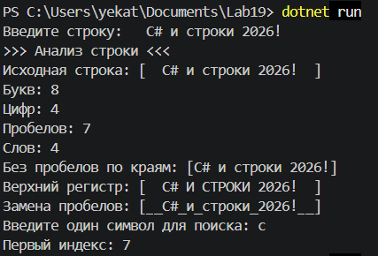

# Практическая работа №19
Автор: Дьяконова Екатерина 
Группа: ИСП-251
## Тема
Строки в C#.
## Что реализовано
- определение длины строки;
- подсчёт букв, цифр, пробелов и слов;
- поиск первого индекса символа;
- удаление пробелов по краям;
- перевод в верхний регистр;
- замена пробелов на подчёркивания.
## Короткие ответы
1. Чем отличаются `string` и `char`?
Ответ: string - это текст из многих символов ("Привет"), а char - ровно один символ ('П').
2. Почему вызов `text.Trim()` без сохранения результата не меняет `text`?
Ответ: Строки в C# неизменяемы. Trim() не редактирует исходный текст, а создает и возвращает новую строку. Если результат не присвоить обратно (text = text.Trim();), исходная переменная text останется прежней.
3. Зачем при разделении строки используется `RemoveEmptyEntries`?
Ответ: Чтобы при разделении текста программа не считала пустые места (из-за лишних пробелов) за отдельные слова.
## Результат
